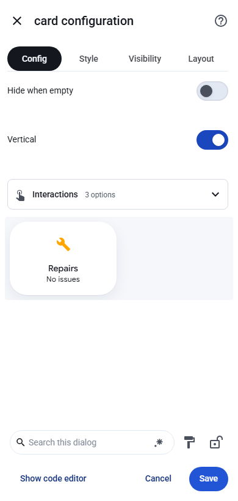

# Edit dashboard elements visually

Open a dashboard, choose **Edit dashboard**, and open an element's editor. If the element
provides a visual form, it shows controls for that element. Otherwise the shared editor shows
the values already present in its configuration. It provides switches for booleans, fields
for numbers and text, an entity picker for the entity field, and expandable controls for
lists and dictionaries. Custom elements can supply their own more specific editors.

On the **Repairs** card, use **Hide when empty** or **Vertical**, and expand **Interactions**
to set tap, hold, and double-tap actions. In a sections dashboard, set the card's grid size
under **Layout**. The card normally opens the Repairs page when tapped.

To try it, open the [sample dashboard](https://ding-ding-projects.github.io/home-assistant-material/demo/#/lovelace/home),
choose **Edit dashboard**, then find **Repairs** in the **Updates** section. Edit **Vertical**,
save, and reload to confirm the setting in the same browser. The demo uses sample records.

The screenshot is from the published demo built at 20:54:10 UTC on 13 November 2026, source
`19c542b8f27b86e6bd7075cfca32984e9584c9f0`. The isolated Chromium check saved the setting,
reloaded the dashboard, and read the saved configuration back. The screenshot SHA-256 is
`f0d1e69cce1e224bac41a7526dc3a2e1f8bf8b11a0c3ca43f9ddd402c14d442c`.

If the editor reports a duplicate key or invalid value, fix the draft before saving. Use
**Show code editor** to edit YAML directly. Keep the component's documentation handy when
adding settings that the component does not describe to Home Assistant.
